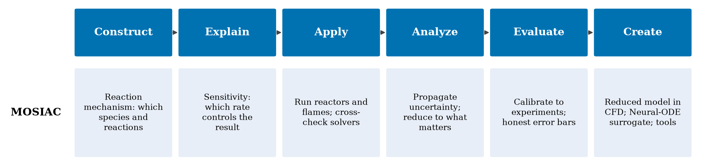

A simulation is only useful to a process engineer if it answers a process question: what do I set, what do I get, how sure am I, and how long does it take to find out? This page walks through how a CFD or finite-element simulation works in the order you meet it, and where my own tools fit.

## 1. Start from the process question

Before any equation, decide what to compute. For a flame it might be the temperature profile; for a gasifier it might be the syngas composition. Write down the knobs you can turn (temperature, pressure, flow rates, fuel and steam ratio) and the responses you care about (yield, composition, stability). A model is a function from the knobs to the responses, and everything below is about making that function trustworthy and cheap.

## 2. Describe the reactor: geometry and mesh

The reactor is cut into many small cells or elements, the mesh. The mesh is finer where things change quickly, such as near walls, a flame front or a thin reaction zone. The first honesty check is that the answer does not depend on the mesh: refine it and the result should settle.

## 3. Write down what must be conserved

Every simulation is a set of balances: mass, momentum, energy and each chemical species. Each says the same thing in words: what accumulates in a small volume equals what flows in, minus what flows out, plus what is made or consumed inside. Diffusion and flow move things around; chemistry and heating are the sources.

## 4. Turn the balances into numbers: finite volumes and finite elements

The **finite-volume** method enforces the balance across the faces of every cell, so what leaves one cell enters the next and nothing is lost. It is the workhorse of CFD codes. The **finite-element** method instead approximates the solution with simple shapes over each element and asks that the error be zero in an averaged sense (the weak form). It handles awkward geometry and several coupled physics at once, such as flow, heat, stress and electromagnetics, which is why multiphysics packages use it. Both end in a very large set of algebraic equations that a solver works through, step by step in time. My own solver, [PANSOPHIA](/projects/cfdcore/), is a clean-room, COMSOL-style multiphysics solver built to understand exactly this chain; its test cases are in the [gallery](/projects/cfd-multiphysics/).

## 5. Chemistry is the hard part

Chemistry enters as source terms: each reaction makes or consumes species at a rate that depends strongly on temperature (an Arrhenius rate). The trouble is **stiffness**: some reactions run vastly faster than others, so the solver must take tiny steps and the chemistry often costs more than everything else combined.

## 6. Make the chemistry trustworthy

The question is not only what the model predicts but how sure we are. [MOSIAC](/projects/mosiac/) is my workbench for that loop: build the reaction mechanism, find which reactions control the result, calibrate against measurements, state the uncertainty, and reduce the model to what matters. A rate constant is a range, not a value.

## 7. Make it fast: an AI surrogate for the chemistry

A Neural ODE learns the rate of change of the chemical state, and a solver integrates it, so it can stand in for the expensive chemistry step inside the flow solver. Two honest points. First, I have run this as a **first demonstration in a small one-dimensional solver of my own**, on one published hydrogen mechanism, and its results are not yet robust to retraining; it is not a validated model. Second, it only trains if the inputs are scaled, because temperature otherwise dominates the error. You can [train a Neural ODE live in your browser](/playground/) and see this.

## 8. What comes out, and what an engineer does with it

A simulation gives profiles and maps, sensitivities (which knob moves the result), uncertainty bands, and, run many times in a designed set of experiments, a response surface and a process window. A fast surrogate turns those into something you can use on the line: quick what-if answers, and a model that can flag when a run has drifted.

## 9. Where my projects fit

- **Solver:** [PANSOPHIA](/projects/cfdcore/) and its [test cases](/projects/cfd-multiphysics/), plus a [finite-element microfluidics solver](/projects/microfluidics/).
- **Chemistry you can trust:** [MOSIAC](/projects/mosiac/), [MUQ-SAC](/projects/muq-sac/) and the [multi-stage objectives](/projects/mso-objectives/).
- **Tuning and design:** [dokimazo](/projects/dokimazo/).
- **Measurement:** [FlameLab](/projects/flamelab/), [gasification](/projects/gasification/) and the [vaporizer rig](/projects/vaporizer-rigs/).
- **Fast surrogates:** the [Neural ODE playground](/playground/) and the [research journey](/projects/sciml/).
